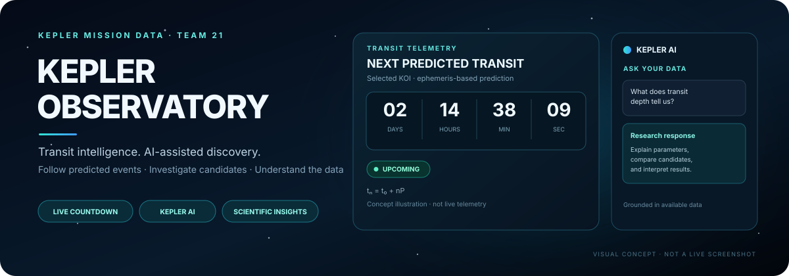
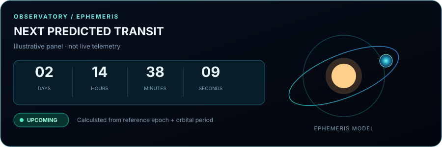
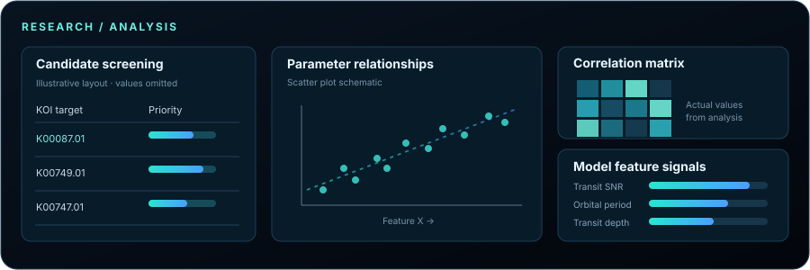
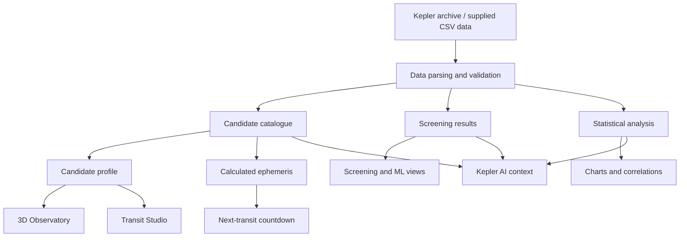

<!--
KEPLER OBSERVATORY
README visual showcase — GitHub-renderable Markdown + Mermaid.
Replace the screenshot placeholders with real application screenshots when available.
-->

<div align="center">

# ✦ KEPLER OBSERVATORY
### AI-Assisted Exoplanet Discovery, Transit Telemetry & Scientific Analysis

**Explore distant worlds. Follow predicted transits. Investigate the data behind discovery.**

[](https://github.com/Harshan-17/Team21_KeplerExoplanetSearchResults)
[](https://science.nasa.gov/mission/kepler/)
[](https://exoplanetarchive.ipac.caltech.edu/)

<br/>



*A space-inspired research platform bringing together Kepler Objects of Interest (KOIs), interactive orbital visualisation, transit timing, machine-learning screening, and statistical exploration.*

</div>

---

## 🌌 The idea

**Kepler Observatory** is an interactive exoplanet research and analysis platform built around NASA's Kepler mission data. It aims to make a large scientific catalogue easier to explore by combining a cinematic observatory with searchable records, calculated transit telemetry, screening results, scientific plots, and an AI research assistant.

Instead of treating the dataset as a spreadsheet alone, the platform connects a selected candidate to its parameters, predicted transit timing, light-curve simulation, and analytical context.

> **Core principle:** the interface should make science easier to investigate—not disguise missing observations with invented data. Observed measurements, calculated predictions, model outputs, and simulations should be clearly distinguished.

<div align="center">

| ✨ Observe | 🔎 Explore | 🛰️ Predict | 🧠 Analyse |
|:---:|:---:|:---:|:---:|
| 3D star–planet scene | Searchable KOI catalogue | Live-updating transit countdown | ML and statistical insights |

</div>

## 🪐 Main experiences

### 1. Interactive 3D Observatory

A cinematic view of a host star and an orbiting exoplanet, designed as the main entry point to the platform.

- Central host star, orbital path, and continuously moving planet.
- Temperature-inspired stellar and planet palettes.
- Procedural surface detail, atmospheric glow, and pointer/touch interaction where supported.
- Observatory telemetry that follows the selected candidate.
- A space-themed HUD with concise scientific parameters.

### 2. Live transit countdown

The Observatory's signature telemetry feature is a countdown to a candidate's next **calculated transit**.

The intended display brings together the target name and KOI, next predicted transit time, a days–hours–minutes–seconds countdown, orbital period, transit duration, transit depth, and an `UPCOMING` / `IN PROGRESS` status.

Transit timing is derived from the candidate's reference epoch and orbital period:

\[
t_n = t_0 + nP
\]

where \(t_0\) is the reference transit epoch, \(P\) is the orbital period, and \(n\) is the integer transit cycle.

For Kepler time values, the project uses the convention:

\[
\mathrm{BKJD} = \mathrm{BJD} - 2454833.0
\]

Countdowns are **ephemeris calculations**, not a claim that a telescope is currently observing the event. Accurate predictions depend on valid source parameters and their uncertainties.

### 3. Explore the Kepler catalogue

Browse the cleaned KOI dataset with candidate search, filters, sorting, pagination, and individual candidate details.

Candidate parameters represented in the project include:

- Archive disposition and disposition score
- Planet radius and orbital period
- Transit epoch, duration, and depth
- Equilibrium temperature and insolation flux
- Transit signal-to-noise ratio (SNR)
- Impact parameter
- Stellar temperature, radius, surface gravity, and Kepler-band magnitude

Missing measurements should be presented as unavailable rather than filled with fabricated values.

### 4. Candidate Screening

A ranked view of the supplied screening results for follow-up prioritisation, including screening probabilities, score and priority tier where present in the data.

The repository's application documentation describes this score as:

\[
\mathrm{Priority\ Score} =
\big(P(\mathrm{confirmed}) + P(\mathrm{candidate})\big) \times 100
\]

The score supports **algorithmic prioritisation**. It is not itself scientific confirmation of a planet.

### 5. Transit Studio

An interactive way to understand how a planet passing in front of its host star produces a dip in measured brightness.

The simulator is based on the approximate depth relationship:

\[
\frac{\Delta F}{F} \approx \left(\frac{R_p}{R_\star}\right)^2
\]

where \(R_p\) is the planet radius and \(R_\star\) is the stellar radius. This is a simplified approximation; stellar limb darkening and transit geometry affect a realistic light curve.

**Simulations must be labelled as simulations**, not as new NASA observations.

### 6. ML Models

A research view for understanding the project's documented model benchmarks, screening signals, model comparisons, and feature diagnostics.

The project materials describe Random Forest and Logistic Regression baselines. Reported benchmark values should be interpreted in the context of the associated training/evaluation workflow, split strategy, and stored outputs; they are not a guarantee of generalisation to unseen data.

### 7. Statistical Insights

Explore the distributions and relationships between exoplanet and stellar parameters through statistical summaries, correlation analysis, heatmaps, and scatter plots where the relevant results are available.

Potential relationships include radius vs. transit depth, orbital period vs. temperature, and transit SNR vs. planet radius. Correlation indicates association, not causation.

### 8. Kepler AI research assistant

A conversational interface intended to help users interpret candidate parameters, transit terminology, screening outputs, and statistical results. When enabled, the Gemini integration should call the model from the server side and keep the API key out of browser code.

AI-generated explanations should be grounded in available data and labelled appropriately. AI access may require a configured API key; data exploration should not depend on the AI service being available.

---

## 🖼️ Visual tour

The diagrams below are **concept illustrations of the product experience**, not screenshots of a verified live deployment. They explain the intended information hierarchy and scientific workflow.

<div align="center">

### Live transit countdown · Concept visual



*Predicted transit time, live-updating timer, orbital parameters, and transit status belong together in one Observatory HUD. Example digits in this illustration are decorative, not live data.*

### Research / Analysis · Concept visual



*The research experience brings candidate prioritisation, scientific relationships, correlation views, and model diagnostics together. Charts should use actual project outputs when running.*

</div>

---

### How the platform connects the science



---

## 📊 Dataset & scientific outputs

The repository includes the following important data and research assets:

| Path | Purpose |
|---|---|
| `data/raw/cumulative.csv` | Raw cumulative Kepler catalogue file |
| `data/raw/processed/kepler_cleaned.csv` | Cleaned dataset used by the project |
| `results/tables/kepler_screening_results.csv` | Candidate screening outputs |
| `notebooks/final_analysis.ipynb` | Research analysis notebook |
| `results/figures/` | Analysis figures, when present |
| `results/tables/` | Tabular analysis results |
| `docs/` | Project presentation and report documents |

The project has been documented around approximately **9,201 Kepler Objects of Interest (KOIs)**. Always use the actual current data file and report the valid loaded row count at runtime; a repository description or an old benchmark should not replace data validation.

### Scientific terms at a glance

| Term | Meaning |
|---|---|
| **KOI** | Kepler Object of Interest; a target associated with a possible transit signal |
| **Transit** | A planet passes in front of its host star from the observer's viewpoint |
| **Transit depth** | The fractional reduction in observed stellar brightness, often expressed in ppm |
| **Transit SNR** | Signal-to-noise ratio used to describe the strength of a transit signal |
| **BKJD** | Barycentric Kepler Julian Date, using the Kepler reference offset convention |
| **Ephemeris** | A model of event timing based on a reference epoch and period |
| **Screening score** | A model-derived prioritisation measure—not an observational confirmation |

---

## 🧰 Technology

This repository is the **scientific data and analysis layer** of the project.

<div align="center">


</div>

The Python dependency file includes **NumPy, pandas, Matplotlib, SciPy, scikit-learn, Jupyter, Streamlit, and joblib**. The separate companion web application is maintained in [KeplerTransit](https://github.com/Harshan-17/KeplerTransit), which contains the interactive React/TypeScript interface and API implementation.

---
## 🚀 Work with the research code

### Prerequisites

- Python 3
- Git
- Jupyter Notebook / JupyterLab (for the notebook workflow)

### 1. Clone this repository

```bash
git clone https://github.com/Harshan-17/Team21_KeplerExoplanetSearchResults.git
cd Team21_KeplerExoplanetSearchResults
```

### 2. Create a Python environment

```bash
python -m venv .venv
```

Activate it, then install the research dependencies:

```bash
pip install -r requirements.txt
```

### 3. Explore the notebook

Open `notebooks/final_analysis.ipynb` in Jupyter and run the cells in order. Check any dataset paths referenced by the notebook or source modules if you launch it from a different working directory.

### 4. Find the companion web app

The interactive web application—including the 3D Observatory, transit countdown, candidate browser, research dashboards, and server-side API—is in the separate repository:

**[Open KeplerTransit on GitHub →](https://github.com/Harshan-17/KeplerTransit)**

That companion application may require Node.js/npm and a server-side `GEMINI_API_KEY` for Gemini AI features. Do not put real API keys in source control or browser code.

---
## ☁️ Deployment & verification

This repository primarily contains the **Python analysis, datasets, and research outputs**; it is not itself the React/Vite web-app root. For the interactive application's runtime and deployment configuration, use [the companion KeplerTransit repository](https://github.com/Harshan-17/KeplerTransit).

A successful frontend build does not by itself confirm that API routes, CSV loading, live transit calculations, or optional Gemini integration work in a hosted environment. For a production check, verify both the root website and the API routes against the active deployment and inspect runtime logs for errors.

---
## 🧭 Project navigation

- **Research/data repository:** [Browse this repository](https://github.com/Harshan-17/Team21_KeplerExoplanetSearchResults)
- **Interactive web application:** [KeplerTransit repository](https://github.com/Harshan-17/KeplerTransit)
- **Data:** [Cleaned Kepler dataset](https://github.com/Harshan-17/Team21_KeplerExoplanetSearchResults/tree/main/data/raw/processed)
- **Screening outputs:** [Results tables](https://github.com/Harshan-17/Team21_KeplerExoplanetSearchResults/tree/main/results/tables)
- **Analysis notebook:** [final_analysis.ipynb](https://github.com/Harshan-17/Team21_KeplerExoplanetSearchResults/blob/main/notebooks/final_analysis.ipynb)
- **Project documents:** [Presentation and report files](https://github.com/Harshan-17/Team21_KeplerExoplanetSearchResults/tree/main/docs)
- **NASA Kepler mission:** [NASA Science](https://science.nasa.gov/mission/kepler/)
- **NASA Exoplanet Archive:** [Archive portal](https://exoplanetarchive.ipac.caltech.edu/)

## ⚠️ Interpretation & limitations

- A KOI is not automatically a confirmed planet.
- A machine-learning score indicates a model assessment; it does not replace scientific confirmation.
- Transit countdowns are calculated from ephemerides and can be affected by parameter uncertainty.
- Transit light curves generated by the simulator are simulations, not direct observations.
- AI responses can be incomplete or incorrect and should be checked against source data.
- Missing or unavailable measurements must not be silently replaced with fabricated values.
- A visual planet surface is an illustrative representation, not a direct image of an exoplanet.

---

<div align="center">

### ✦ From transit signals to scientific insight

**KEPLER OBSERVATORY**  
*Observe · Explore · Predict · Analyse*

Built as an exoplanet data exploration and research project by **Team 21 — Hack vok**.

</div>
