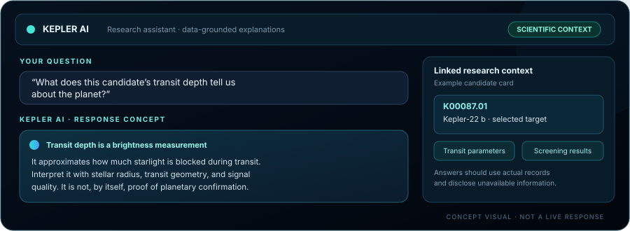
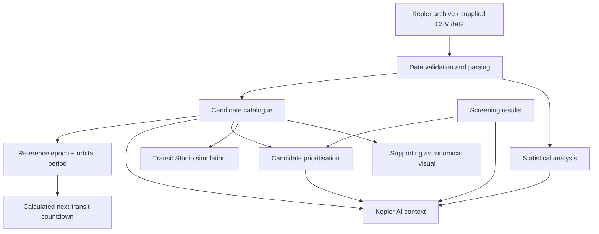

<!--
KEPLER OBSERVATORY
README visual showcase — GitHub-renderable Markdown + Mermaid.
Replace the screenshot placeholders with real application screenshots when available.
-->

<div align="center">

# ✦ KEPLER OBSERVATORY
### Live Transit Intelligence · Kepler AI · Exoplanet Research

**Track the next transit. Ask better scientific questions. Turn Kepler data into insight.**

[](https://github.com/Harshan-17/Team21_KeplerExoplanetSearchResults)
[](https://science.nasa.gov/mission/kepler/)
[](https://exoplanetarchive.ipac.caltech.edu/)

<br/>


*An AI-assisted research experience centred on predicted transit events, candidate intelligence, scientific analysis, and clear explanations of Kepler mission data.*

</div>

---

## 🌌 The idea

**Kepler Observatory is built around transit intelligence and scientific discovery.** It helps users understand *when a candidate may transit next*, explore what its parameters mean, compare screening results, and ask research questions grounded in the available Kepler dataset.

The experience is organised around four connected goals: **predict, explain, discover, and analyse**. A selected candidate links its archive measurements to calculated ephemeris timing, screening information, charts, and contextual AI assistance. A restrained astronomical visual layer supports the experience; it is not the product's main purpose.

> **Scientific principle:** keep observations, calculated predictions, simulations, and machine-learning outputs distinct. Predictions and model scores can inform investigation, but they do not replace observational confirmation.

<div align="center">

| ⏱️ Predict | 🤖 Explain | 🔎 Discover | 📈 Analyse |
|:---:|:---:|:---:|:---:|
| Next-transit countdown | Kepler AI research assistant | Searchable KOI catalogue | ML and statistical insights |

</div>

## ⭐ Main experiences

### 1. Live transit countdown — the signature feature

Track the next **calculated transit** for a selected Kepler candidate. The countdown is intended to show days, hours, minutes, and seconds alongside the target's KOI identifier, predicted transit time, orbital period, transit duration, transit depth, and `UPCOMING` / `IN PROGRESS` status.

Transit timing follows the ephemeris relation:

\[
t_n = t_0 + nP
\]

where \(t_0\) is the reference transit epoch, \(P\) is the orbital period, and \(n\) is the transit cycle number. The Kepler time convention used by the project is:

\[
\mathrm{BKJD} = \mathrm{BJD} - 2454833.0
\]

The countdown should update from real timestamps, not a frozen timer. It represents a **prediction from ephemeris parameters**, not confirmation that a telescope is observing the event. Parameter uncertainty can affect predicted timing.

### 2. Kepler AI — research assistant

Ask questions about candidate parameters, transit depth, orbital timing, screening output, model behaviour, and statistical relationships.

The intended assistant helps users:
- Interpret a selected candidate's available measurements and units.
- Explain transit physics and ephemeris calculations.
- Compare candidate records and screening results.
- Summarise relationships found in analysis outputs.
- Identify when values are unavailable or evidence is insufficient.

The companion application includes a Gemini integration path. AI access may require a server-side `GEMINI_API_KEY`; never expose the key in browser code. AI explanations should be grounded in data and checked against source results.

### 3. Explore — searchable Kepler candidate catalogue

Browse the cleaned KOI dataset through search, filters, sorting, pagination, and candidate profiles. Search targets by KOI identifier, official planet name, or Kepler identifier.

Candidate measurements represented in the project include:

- Archive disposition and disposition score
- Planetary radius and orbital period
- Transit epoch, duration, and depth
- Equilibrium temperature and insolation flux
- Transit signal-to-noise ratio (SNR)
- Impact parameter
- Stellar temperature, radius, surface gravity, and Kepler-band magnitude

Missing measurements should be displayed as unavailable rather than invented. Candidate selection is designed to connect the record with its calculated timing and relevant research views.

### 4. Candidate Screening — prioritise follow-up

Explore the supplied screening output by score, probability, and priority tier when those fields are available. Review ranked candidates, inspect the supporting parameters, and understand why a target might be prioritised for additional investigation.

The project describes the screening score as:

\[
\mathrm{Priority\ Score} =
\big(P(\mathrm{confirmed}) + P(\mathrm{candidate})\big) \times 100
\]

This score is an **algorithmic prioritisation measure**, not scientific proof that a planet is confirmed.

### 5. Statistical Insights — find patterns in the data

Explore distributions and relationships across stellar and planetary parameters through statistical summaries, correlation analysis, heatmaps, and scatter plots where source results are available.

Examples include:
- Planet radius versus transit depth.
- Orbital period versus equilibrium temperature.
- Transit SNR versus planet radius.
- Transit duration and orbital parameters.

Useful scientific context includes units, sample counts, missing-value handling, and statistical interpretation. Correlation indicates association, not causation.

### 6. ML Models — understand the screening signals

Review the project's documented Random Forest and Logistic Regression benchmarks, feature diagnostics, confusion matrices, and model comparisons where the corresponding stored outputs are available.

Metrics must be interpreted in the context of how the model was trained and evaluated. Do not treat a benchmark as a guarantee of performance on new data or present it as independently reproduced unless that validation has been performed.

### 7. Transit Studio — see how a transit signal forms

Explore a planet passing in front of its host star with a light-curve simulation. Candidate parameters can inform the simulation where supported.

The simplified transit-depth relation is:

\[
\frac{\Delta F}{F} \approx \left(\frac{R_p}{R_\star}\right)^2
\]

where \(R_p\) is planet radius and \(R_\star\) is stellar radius. This is an approximation; geometry and stellar limb darkening influence real transit profiles.

Simulated curves must be labelled as **simulations**, not as direct NASA observations.

### 8. Supporting astronomical visualisation

A subtle star-and-orbit scene can provide visual context for the selected candidate and add depth to the experience. It supports candidate selection and transit storytelling; the primary value of the platform remains countdown telemetry, AI-assisted interpretation, real-data exploration, and scientific analysis.

## 🖼️ Visual tour

The visuals below are **custom concept illustrations**, not screenshots of a verified live deployment. They show the information hierarchy and intended research experience.

<div align="center">

### The core experience · Predicted transit countdown


*The next predicted event, live-updating timer, selected target, and transit status are the first things users should understand. Countdown digits are illustrative, not live data.*

### Kepler AI · Ask questions about the data



*The assistant is designed to explain available parameters and research results, while distinguishing source data from interpretation.*

### Candidate screening and scientific insights


*Screening, statistical plots, correlations, and model diagnostics provide the analysis behind the countdown and AI answers.*

</div>

---

### How the research flow connects



---

## 📊 Dataset & scientific outputs

The repository includes the following important data and research assets:

| Path | Purpose |
|---|---|
| `data/raw/cumulative.csv` | Raw cumulative Kepler catalogue file |
| `data/raw/processed/kepler_cleaned.csv` | Cleaned dataset used by the project |
| `results/tables/kepler_screening_results.csv` | Candidate screening outputs |
| `notebooks/final_analysis.ipynb` | Research analysis notebook |
| `results/figures/` | Analysis figures, when present |
| `results/tables/` | Tabular analysis results |
| `docs/` | Project presentation and report documents |

The project has been documented around approximately **9,201 Kepler Objects of Interest (KOIs)**. Always use the actual current data file and report the valid loaded row count at runtime; a repository description or an old benchmark should not replace data validation.

### Scientific terms at a glance

| Term | Meaning |
|---|---|
| **KOI** | Kepler Object of Interest; a target associated with a possible transit signal |
| **Transit** | A planet passes in front of its host star from the observer's viewpoint |
| **Transit depth** | The fractional reduction in observed stellar brightness, often expressed in ppm |
| **Transit SNR** | Signal-to-noise ratio used to describe the strength of a transit signal |
| **BKJD** | Barycentric Kepler Julian Date, using the Kepler reference offset convention |
| **Ephemeris** | A model of event timing based on a reference epoch and period |
| **Screening score** | A model-derived prioritisation measure—not an observational confirmation |

---

## 🧰 Technology

This repository is the **scientific data and analysis layer** of the project.

<div align="center">


</div>

The Python dependency file includes **NumPy, pandas, Matplotlib, SciPy, scikit-learn, Jupyter, Streamlit, and joblib**. The separate companion web application is maintained in [KeplerTransit](https://github.com/Harshan-17/KeplerTransit), which contains the interactive React/TypeScript interface and API implementation.

---
## 🚀 Work with the research code

### Prerequisites

- Python 3
- Git
- Jupyter Notebook / JupyterLab (for the notebook workflow)

### 1. Clone this repository

```bash
git clone https://github.com/Harshan-17/Team21_KeplerExoplanetSearchResults.git
cd Team21_KeplerExoplanetSearchResults
```

### 2. Create a Python environment

```bash
python -m venv .venv
```

Activate it, then install the research dependencies:

```bash
pip install -r requirements.txt
```

### 3. Explore the notebook

Open `notebooks/final_analysis.ipynb` in Jupyter and run the cells in order. Check any dataset paths referenced by the notebook or source modules if you launch it from a different working directory.

### 4. Find the companion web app

The interactive web application—including the transit countdown, Kepler AI interface, candidate browser, research dashboards, supporting astronomical visualisation, and server-side API—is in the separate repository:

**[Open KeplerTransit on GitHub →](https://github.com/Harshan-17/KeplerTransit)**

That companion application may require Node.js/npm and a server-side `GEMINI_API_KEY` for Gemini AI features. Do not put real API keys in source control or browser code.

---
## ☁️ Deployment & verification

This repository primarily contains the **Python analysis, datasets, and research outputs**; it is not itself the React/Vite web-app root. For the interactive application's runtime and deployment configuration, use [the companion KeplerTransit repository](https://github.com/Harshan-17/KeplerTransit).

A successful frontend build does not by itself confirm that API routes, CSV loading, live transit calculations, or optional Gemini integration work in a hosted environment. For a production check, verify both the root website and the API routes against the active deployment and inspect runtime logs for errors.

---
## 🧭 Project navigation

- **Research/data repository:** [Browse this repository](https://github.com/Harshan-17/Team21_KeplerExoplanetSearchResults)
- **Interactive web application:** [KeplerTransit repository](https://github.com/Harshan-17/KeplerTransit)
- **Data:** [Cleaned Kepler dataset](https://github.com/Harshan-17/Team21_KeplerExoplanetSearchResults/tree/main/data/raw/processed)
- **Screening outputs:** [Results tables](https://github.com/Harshan-17/Team21_KeplerExoplanetSearchResults/tree/main/results/tables)
- **Analysis notebook:** [final_analysis.ipynb](https://github.com/Harshan-17/Team21_KeplerExoplanetSearchResults/blob/main/notebooks/final_analysis.ipynb)
- **Project documents:** [Presentation and report files](https://github.com/Harshan-17/Team21_KeplerExoplanetSearchResults/tree/main/docs)
- **NASA Kepler mission:** [NASA Science](https://science.nasa.gov/mission/kepler/)
- **NASA Exoplanet Archive:** [Archive portal](https://exoplanetarchive.ipac.caltech.edu/)

## ⚠️ Interpretation & limitations

- A KOI is not automatically a confirmed planet.
- A machine-learning score indicates a model assessment; it does not replace scientific confirmation.
- Transit countdowns are calculated from ephemerides and can be affected by parameter uncertainty.
- Transit light curves generated by the simulator are simulations, not direct observations.
- AI responses can be incomplete or incorrect and should be checked against source data.
- Missing or unavailable measurements must not be silently replaced with fabricated values.
- A visual planet surface is an illustrative representation, not a direct image of an exoplanet.
- Example countdown and assistant panels in this README are concept illustrations; they do not represent live transit telemetry or an active AI response.

---

<div align="center">

### ✦ From transit signals to scientific insight

**KEPLER OBSERVATORY**  
*Observe · Explore · Predict · Analyse*

Built as an exoplanet data exploration and research project by **Team 21 — Hack vok**.

</div>
